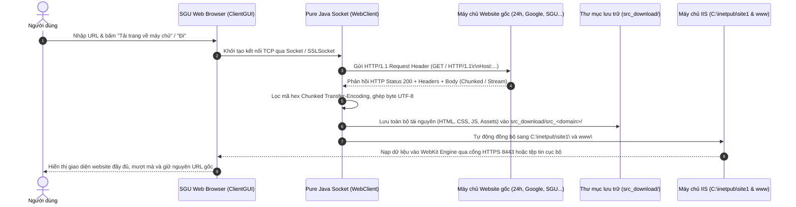

# SGU Web Browser & HTTP Socket Client (Kèm Máy Chủ IIS)

> **Đồ án môn học:** Lập trình mạng (Network Programming) - Đại học Sài Gòn (SGU)  
> **Chủ đề:** HTTP/1.1 Protocol, Pure Java Socket Client, Multi-threading & Triển khai Hosting Microsoft IIS  

---

## 📌 1. Tổng Quan Dự Án

Dự án xây dựng một **Trình duyệt Web hiện đại (SGU Web Browser)** theo phong cách Google Chrome kết hợp cùng **Hệ thống thu thập & lưu trữ mã nguồn website cục bộ** trên nền tảng máy chủ **Microsoft IIS (Internet Information Services)**:
* **Giao thức mạng:** Tự lập trình bắt tay TCP và gửi/nhận HTTP/1.1 thô bằng **Pure Java Socket (`Socket` và `SSLSocket`)**, không phụ thuộc vào thư viện HTTP Client cấp cao có sẵn.
* **Động cơ hiển thị (Web Engine):** Tích hợp WebKit qua JavaFX WebEngine, cho phép kết xuất (render) 100% hình ảnh, bố cục CSS, phông chữ tiếng Việt và JavaScript chân thực.
* **Máy chủ ứng dụng:** Kết hợp máy chủ Java Web Server nội bộ (port 8080) và máy chủ IIS doanh nghiệp (cổng HTTPS 8443 / HTTP 80) để đóng vai trò lưu trữ bản sao website (Local Web Mirroring).

---

## 🏗️ 2. Luồng Hoạt Động Chi Tiết (Architecture & Data Flow)

### 2.1 Sơ Đồ Trình Tự (Sequence Diagram)



---

### 2.2 Giải Thích Từng Bước Trong Luồng

1. **Bắt tay TCP Socket thô:**
   * Khi người dùng nhập một địa chỉ website (ví dụ: `https://www.24h.com.vn`), `WebClient` phân tích URL để tách `Host` và `Port` (mặc định port 80 cho HTTP và 443 cho HTTPS).
   * Ứng dụng tạo `javax.net.ssl.SSLSocket` đối với HTTPS hoặc `java.net.Socket` đối với HTTP. Quá trình bắt tay mã hóa TLS/SSL được thực thi trực tiếp ở tầng Transport.
2. **Soạn thảo và gửi HTTP Request Header:**
   * Client trực tiếp ghi các dòng văn bản theo đặc tả RFC 2616:
     ```http
     GET / HTTP/1.1
     Host: www.24h.com.vn
     User-Agent: Mozilla/5.0 (Windows NT 10.0; Win64; x64) Chrome/124.0.0.0 Safari/537.36
     Accept: text/html,application/xhtml+xml,application/xml;q=0.9,*/*;q=0.8
     Connection: close
     ```
3. **Bóc tách HTTP Response & Giải mã Transfer-Encoding:**
   * Client đọc luồng byte từ Socket qua `BufferedInputStream`.
   * Tách phần **Headers** (ngăn cách bởi chuỗi byte `\r\n\r\n` hay `0x0D 0x0A 0x0D 0x0A`).
   * Phân tích `Content-Type`, `Content-Length` và kiểm tra `Transfer-Encoding: chunked`.
   * **Xử lý Chunked Encoding:** Máy chủ web hiện đại thường gửi dữ liệu dạng từng khối kèm độ dài thập lục phân (hex length). Thuật toán bóc tách tầng byte của `WebClient` tự động loại bỏ các đoạn hex length, ghép chính xác các khối nhị phân và giải mã văn bản chuẩn UTF-8.
4. **Trích xuất & Lưu trữ cấu trúc Domain (`src_download/`):**
   * Tất cả các file tải về được tổ chức ngăn nắp vào thư mục riêng biệt theo từng domain: `src_download/src_24h/`, `src_download/src_google/`, v.v.
   * `WebClient` chèn thẻ `<base href="...">` hợp lệ để đảm bảo toàn bộ đường dẫn tương đối (CSS, hình ảnh, font chữ) vẫn trỏ đúng về máy chủ tài nguyên tĩnh mà không bị lỗi 404.
5. **Đồng bộ vào IIS & Hiển thị tức thì:**
   * Ngay khi hoàn tất tải về, mã nguồn được đồng bộ tự động vào `C:\inetpub\site1\` và thư mục `www\`.
   * Trình duyệt nạp thẳng vào WebKit và cập nhật thanh địa chỉ về URL thực tế (`https://www.24h.com.vn`), mang lại trải nghiệm duyệt web trực quan.

---

## ❓ 3. Tại Sao Phải Cần IIS? (Bản Chất Yêu Cầu Đồ Án)

Nhiều bạn thắc mắc: *"Đã có Java Web Server rồi, tại sao lại phải cần Microsoft IIS?"*

| Tiêu chí | Java Socket Server tự viết | Microsoft IIS (Internet Information Services) |
| :--- | :--- | :--- |
| **Vai trò đồ án** | Trình thu thập dữ liệu & Demo giao thức thô | Máy chủ lưu trữ & phát hành nội bộ (Enterprise Web Host) |
| **Mục đích môn học** | Hiểu bản chất Socket, bắt tay TCP, HTTP Request/Response | Hiểu cách triển khai Web Server công nghiệp trên hệ điều hành Windows Server |
| **Xử lý MIME Types** | Chỉ hỗ trợ cơ bản (html, css, js đơn giản) | Đầy đủ chuẩn MIME (woff2, svg, json, webp, mp4, api...) thông qua `web.config` |
| **Bảo mật & HTTPS** | Phức tạp trong việc quản lý keystore | Hỗ trợ cấu hình chứng chỉ số SSL/TLS tự ký (Self-Signed Cert) trực quan qua GUI |
| **Khả năng chịu tải** | Phù hợp demo học tập | Xử lý đa luồng cấp Kernel (HTTP.sys), pooling và multi-tenancy chuyên nghiệp |

> **💡 Ý nghĩa thực tiễn:**  
> Trong môi trường mạng doanh nghiệp hoặc kiểm toán an ninh, các hệ thống thường dùng một ứng dụng trung gian (Java Client) để thu thập mã nguồn các website bên ngoài, sau đó đưa vào máy chủ nội bộ (IIS Server trên Windows) để lưu trữ bản sao (offline mirror), kiểm soát truy cập và bảo vệ dữ liệu mạng cục bộ.

---

## 🚀 4. Hướng Dẫn Cài Đặt & Chạy Ứng Dụng Bằng Maven

### 4.1 Điều kiện tiên quyết
* **Hệ điều hành:** Windows 10/11 (đã kích hoạt tính năng IIS trong Windows Features).
* **JDK:** Java Development Kit phiên bản **17** trở lên.
* **Apache Maven:** Phiên bản **3.8.x** trở lên (kiểm tra bằng lệnh `mvn -v`).

---

### 4.2 Lệnh Biên Dịch & Đóng Gói (Build)

Mở PowerShell hoặc CMD tại thư mục gốc của dự án (`HTTP-app-main`):

```bash
# 1. Dọn dẹp thư mục target và biên dịch toàn bộ source code
mvn clean compile

# 2. Đóng gói ra file JAR hoàn chỉnh (bỏ qua kiểm thử)
mvn package -DskipTests
```

Sau khi hoàn tất, file thực thi độc lập sẽ nằm tại:  
👉 `target/httpapp-1.0-SNAPSHOT-jar-with-dependencies.jar`

---

### 4.3 Khởi Chạy Ứng Dụng

#### Cách 1: Chạy trực tiếp qua lệnh Maven (Khuyên dùng khi lập trình)
```bash
mvn exec:java
```
*Lệnh này sẽ tự động khởi động Java Server ngầm và mở giao diện trình duyệt Web Client với kích thước phóng to tối đa màn hình.*

#### Cách 2: Chạy trực tiếp qua file JAR đã đóng gói
```bash
java -jar target/httpapp-1.0-SNAPSHOT-jar-with-dependencies.jar
```

---

## ⌨️ 5. Bảng Phím Tắt Tiện Ích Trình Duyệt

Giao diện được trang bị hệ thống phím tắt kép (hỗ trợ cả khi con trỏ đang ở trong trang web WebEngine lẫn trên thanh công cụ Swing):

| Phím tắt | Chức năng | Chi tiết |
| :---: | :--- | :--- |
| **`F5`** hoặc **`Ctrl + R`** | **Tải lại trang (Reload)** | Tải lại trang web đang xem trong thẻ hiện tại. |
| **`Ctrl + T`** | **Mở thẻ mới (New Tab)** | Mở một tab mới với trang chủ `about:home`. |
| **`Ctrl + W`** | **Đóng thẻ (Close Tab)** | Đóng tab đang xem (nếu chỉ còn 1 tab, sẽ tự chuyển về trang chủ). |
| **`Ctrl + L`** hoặc **`Alt + D`** | **Chọn thanh địa chỉ (Omnibox)** | Nhảy con trỏ lên thanh URL và bôi đen toàn bộ để gõ link mới nhanh chóng. |
| **`Alt + ←`** | **Quay lại (Back)** | Trở về trang web trước đó trong lịch sử duyệt. |
| **`Alt + →`** | **Tiến tới (Forward)** | Đi đến trang web kế tiếp. |

---

## 📁 6. Cấu Trúc Thư Mục Dự Án

```text
HTTP-app-main/
├── src/
│   ├── main/
│   │   ├── java/com/example/
│   │   │   ├── client/
│   │   │   │   ├── ClientGUI.java       # Giao diện trình duyệt phong cách Chrome
│   │   │   │   └── WebClient.java       # Bộ xử lý Pure Socket HTTP/HTTPS & Crawler
│   │   │   ├── server/
│   │   │   │   ├── ClientHandler.java   # Xử lý kết nối Socket của server cục bộ
│   │   │   │   ├── ServerGUI.java       # Giao diện điều khiển Web Server nội bộ
│   │   │   │   └── WebServer.java       # Lắng nghe ServerSocket cổng 8080
│   │   │   └── Main.java                # Điểm khởi động ứng dụng
│   │   └── resources/                   # Tài nguyên hệ thống (logo các kích thước)
├── src_download/                        # Nơi lưu trữ tập trung mã nguồn các website đã tải
│   ├── src_24h/                         # Thư mục mã nguồn Báo 24h
│   └── src_google/                      # Thư mục mã nguồn Google
├── www/                                 # Web root phụ vụ Web Server nội bộ
├── target/                              # Thư mục chứa mã bytecode và file JAR đóng gói
├── pom.xml                              # Cấu hình dependency Maven (FlatLaf, JavaFX)
├── README.md                            # Tài liệu giải thích kiến trúc và hướng dẫn sử dụng
└── HUONG_DAN_IIS_CHROME.md              # Hướng dẫn chi tiết các bước cấu hình IIS thực hành
```

---

## 👨‍🏫 7. Tóm Tắt Trả Lời Khi Vấn Đáp Giảng Viên

1. **"Ứng dụng này có dùng thư viện HTTP hay API của Chrome để tải web không?"**
   * *Trả lời:* Tuyệt đối không. Ứng dụng dùng lớp `java.net.Socket` và `javax.net.ssl.SSLSocket` để mở kết nối TCP tới cổng 80/443 của website, gửi chuỗi `GET / HTTP/1.1\r\nHost:...` và tự bóc tách byte nhận về theo đúng chuẩn giao thức HTTP RFC 2616.
2. **"Mã nguồn sau khi tải được lưu ở đâu và làm sao IIS chạy được?"**
   * *Trả lời:* Toàn bộ được tổ chức vào thư mục `src_download/src_<tên_trang>/`. Ứng dụng tự sao chép vào `C:\inetpub\site1\` (thư mục Physical Path của IIS). IIS lắng nghe tại cổng `8443 (HTTPS)` và phát hành website nội bộ.
3. **"Tại sao trang web tải về vẫn hiển thị được hình ảnh và CSS?"**
   * *Trả lời:* Trình bóc tách tự động gắn thẻ `<base href="...">` trỏ về domain gốc của trang web, giúp các đường dẫn tương đối (relative links) của hình ảnh, font và stylesheet được tải đầy đủ.

---

## 🛠 8. Hướng Dẫn Cấu Hình IIS Thủ Công Liên Kết Trực Tiếp Với File .JAR

> **Bản chất mối liên kết**: File `.jar` đóng vai trò là **Client Controller & Web Manager**. IIS đóng vai trò là **Web Server Doanh Nghiệp (Host)**. Khi IIS được cấu hình **Physical Path** trỏ vào thư mục của ứng dụng (hoặc `C:\inetpub\site1`), mọi thao tác thêm/sửa/xóa trên file `.jar` sẽ phản ánh **ngay lập tức** trên IIS mà không cần restart máy chủ!

### Các bước thao tác bằng tay trên IIS Manager (`inetmgr`):

1. **Bước 1: Mở IIS Manager**
   * Nhấn tổ hợp phím `Windows + R`, gõ `inetmgr` rồi nhấn **Enter**.
2. **Bước 2: Tạo chứng chỉ SSL tự ký (Self-Signed Certificate)**
   * Ở cột bên trái, click vào tên máy tính của bạn (Server Name).
   * Ở khung giữa, tìm và double-click vào biểu tượng **Server Certificates**.
   * Ở cột bên phải (Actions), click **Create Self-Signed Certificate...**
   * Đặt tên: `IIS-Lab-SSL` rồi nhấn **OK**.
3. **Bước 3: Thêm Website liên kết với thư mục dự án**
   * Ở cột bên trái, chuột phải vào thư mục **Sites** ➔ chọn **Add Website...**
   * Điền thông tin cấu hình:
     * **Site name:** `Site1` (hoặc `JavaWebLink`)
     * **Physical path:** Bấm nút `...` và chọn một trong 2 cách:
       * **Cách 1 (Chuẩn mặc định):** Chọn `C:\inetpub\site1` (File `.jar` sẽ tự động đồng bộ dữ liệu vào đây).
       * **Cách 2 (Trỏ thẳng vào mã nguồn):** Chọn thẳng thư mục dự án `...\HTTP-app-main\src_download\src_24h`
     * **Binding:**
       * **Type:** chọn `https`
       * **Port:** điền `8443` (hoặc `443` nếu không trùng)
       * **SSL Certificate:** chọn chứng chỉ `IIS-Lab-SSL` vừa tạo ở Bước 2.
   * Nhấn **OK** để hoàn tất.
4. **Bước 4: Kiểm tra liên kết**
   * Mở trình duyệt (hoặc trình duyệt Java), truy cập `https://localhost:8443`.
   * IIS sẽ phục vụ chính xác những tập tin mà file `.jar` đã tải về hoặc tạo ra!

---

## 🎭 9. Kịch Bản Demo Cho Giảng Viên Xem (2 Chế Độ & Quản Lý Xóa)

Trên thanh công cụ của ứng dụng đã được thiết kế sẵn **2 nút chế độ riêng biệt**:

### ⚡ Chế độ 1: Tải Tự Động (Auto Crawler via Socket)
1. Nhập một URL bất kỳ vào thanh địa chỉ (ví dụ: `https://www.24h.com.vn` hoặc `https://www.google.com`).
2. Bấm nút **`[⚡ Tải Tự Động]`**.
3. Hệ thống sẽ mở hộp thoại xác nhận tải ➔ Bạn chọn **Có / Đồng ý**.
4. Pure Java Socket sẽ kết nối, tải HTML, CSS, tạo thẻ `<base href="...">`, lưu vào `src_download/src_<name>/`, tự động đẩy sang IIS và tự chuyển hướng mở trang local ngay lập tức.

### ✍ Chế độ 2: Thêm Thủ Công (Manual Mode)
Dành riêng để show cho thầy thấy bạn có thể tự tay tạo hoặc import website mà không cần cào mạng:
1. Bấm nút **`[✍ Thêm Thủ Công]`** (hoặc nút `+ Thêm Website Thủ Công` tại trang chủ `about:home`).
2. Xuất hiện hộp thoại với 3 lựa chọn trực quan:
   * **Lựa chọn 1 - Tự tạo trang web mới (Nhập mã HTML bằng tay):**
     * Nhập mã định danh (ví dụ: `demo_thay_xem`).
     * Nhập tiêu đề trang.
     * Tự gõ hoặc paste mã HTML tùy chỉnh (đã có sẵn khung mẫu đẹp mắt).
     * Bấm **Lưu & Đưa lên IIS** ➔ Ứng dụng tự ghi file và IIS phục vụ ngay lập tức!
   * **Lựa chọn 2 - Import thư mục website có sẵn:**
     * Bấm Browse để chọn bất kỳ thư mục web nào có sẵn trên máy (chứa `index.html`).
     * Ứng dụng sẽ nạp thư mục đó vào hệ thống và kích hoạt trên IIS.
   * **Lựa chọn 3 - Mở thư mục Windows Explorer để copy/paste bằng tay:**
     * Bấm mở thư mục `src_download` hoặc `C:\inetpub\site1` để thao tác trực tiếp trước mặt giảng viên.

### ❌ Tính năng Quản lý & Xóa Website (Delete Site)
* **Xóa nhanh trực tiếp trên giao diện:** Tại trang chủ `about:home`, mỗi thẻ website đều có nút **`×` (màu đỏ)** ở góc trên bên phải. Chỉ cần click vào `×` ➔ Xác nhận Xóa ➔ Website sẽ bị xóa vĩnh viễn khỏi thư mục lưu trữ và IIS, giao diện tự động cập nhật ngay.
* **Xóa qua Menu Tùy chọn:** Bấm nút menu **`≡`** trên thanh công cụ ➔ Chọn **Quản lý & Xóa Website** ➔ Chọn website cần xóa trong danh sách.

